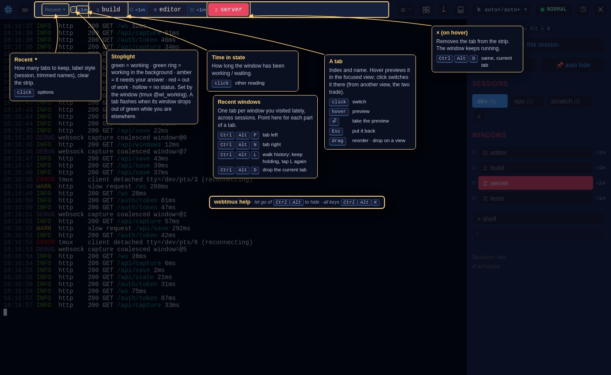
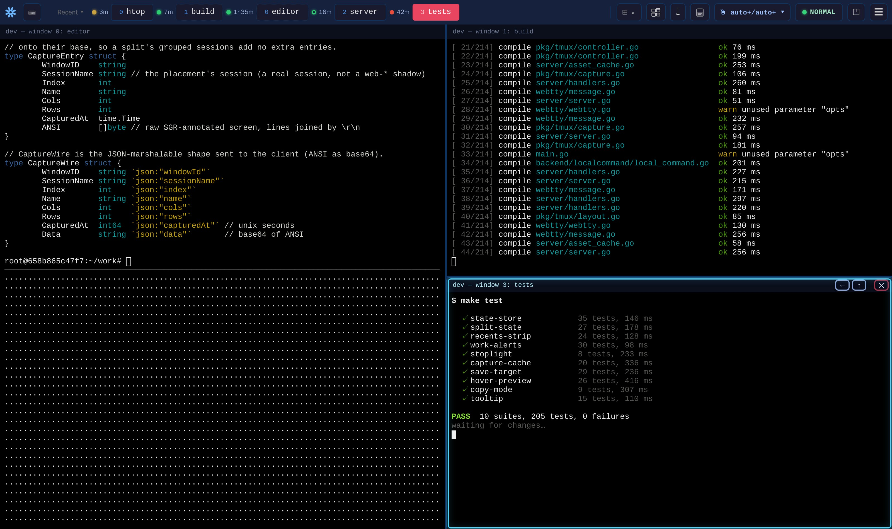
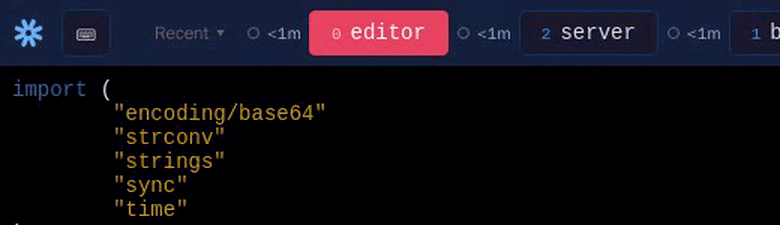

# webtmux

A web-based terminal with tmux-specific features. Access your tmux sessions from any browser with a visual pane layout, touch-friendly controls, and automatic scroll-to-copy-mode. Most importantly, see at a glance which of your windows are working and which are idle. Get notified when a window is ready for more work!

- **[Every feature explains itself](#help-overlay--discover-everything).** Hold `Ctrl+Option` for a second and a help overlay points at every part of the screen — what it does and its keys — opening up into more detail wherever you move the mouse. No manual to read, no shortcuts to memorise.
- Multiple ways ([Exposé](#windows-mosaic), [Corner PiP, Preview Bar](#preview-and-picture-in-picture), [Sidebar](#windows-view-in-sidebar), [Recents Tabs](#toolbar-and-recent-tabs)) to [quickly monitor](#hover-previews) and access your tmux windows.
- [Get notified with visuals](#stoplights-and-work-alerts) when your tmux windows are done working, are prompting for input or are idle waiting for more work.
  - Perfect for working with AI coding agents - know exactly when they are done/need input
  - **setup required for feature to work**
- **Your tmux muscle memory carries straight over.** Shortcuts use the same key as tmux, with `Ctrl+Option` in place of the `Ctrl+B` prefix — `Ctrl+Option+W` ⇄ `Ctrl+B, w`. [Full list](#keyboard-navigation--discoverability).
- [Copy several things and paste them one at a time](#copy-buffers) - a list of copy buffers, one of which is the clipboard, that only grows when you are actually gathering.
- [A program's "press c to copy" reaches YOUR clipboard](#a-programs-press-c-to-copy-reaches-your-clipboard) - the login URL a CLI offers on the tmux machine lands on the clipboard of the machine you are sitting at, which stock tmux silently drops.
- Take advantage of modern UI - Use Drag and Drop, [Previews on hover](#hover-previews) etc to manage your tmux state.
- [Quickly access your most recent windows](#toolbar-and-recent-tabs). [Monitor any window](#preview-and-picture-in-picture), keeping it always in your view.

## Quick Start

Two ways in: reach tmux on another machine from your laptop with `webtmux-launch`,
or run webtmux on the machine whose tmux you want.

### tmux on another machine — `webtmux-launch`

Download the launcher for your laptop from the
[latest release](https://github.com/sparant/webtmux/releases/latest)
([Apple Silicon](https://github.com/sparant/webtmux/releases/latest/download/webtmux-launch-darwin-arm64),
[Intel Mac](https://github.com/sparant/webtmux/releases/latest/download/webtmux-launch-darwin-amd64),
[Linux x64](https://github.com/sparant/webtmux/releases/latest/download/webtmux-launch-linux-amd64),
[Windows x64](https://github.com/sparant/webtmux/releases/latest/download/webtmux-launch-windows-amd64.exe),
[Windows on Arm](https://github.com/sparant/webtmux/releases/latest/download/webtmux-launch-windows-arm64.exe)),
then point it at any box you can already SSH to:

```bash
curl -fsSL -o webtmux-launch \
  https://github.com/sparant/webtmux/releases/latest/download/webtmux-launch-darwin-arm64
chmod +x webtmux-launch
./webtmux-launch linuxbox        # or you@203.0.113.10, ssh://you@host:38242, an ~/.ssh/config alias
```

It installs webtmux on the target if needed, starts it, tunnels it back to your
laptop, opens your browser, and reconnects when the link drops. **The target
needs nothing but `ssh` and `tmux`** — if `ssh <target>` works,
`webtmux-launch <target>` works. Missing one? See
[Installing ssh and tmux](#installing-ssh-and-tmux). More:
[naming the target](#naming-the-target), [flags](#webtmux-launch-flags),
[how it works](#how-webtmux-launch-works).

### tmux on this machine

**With the launcher.** Run it with no target (or `localhost`, or one of this
machine's own addresses): `./webtmux-launch`. It installs and starts webtmux
here, opens your browser, and keeps it running until you quit. On Windows,
`webtmux-launch wsl` does the same for tmux in WSL.

**With `webtmux` directly.** You don't need the launcher at all: put webtmux on
the machine whose tmux you want and run it there. The trade-off: connecting to
it is up to you — no tunnel, reconnects or secret URL — so reaching it from
another machine means your own access (for example
`ssh -L 8080:localhost:8080 <host>`, then <http://localhost:8080> on your laptop).

```bash
curl -fsSL -o webtmux \
  https://github.com/sparant/webtmux/releases/latest/download/webtmux-linux-amd64
chmod +x webtmux
./webtmux -a 127.0.0.1 -w tmux new-session -A -s main
```

`-a 127.0.0.1` keeps webtmux reachable only from this machine (`127.0.0.1` means
"this machine" on every computer — it is not your network IP). Drop it to listen
on all interfaces, but the login is plain HTTP, so only on a network you trust.

Then open <http://localhost:8080> on that machine (or through your tunnel). Other platforms, checksum verification and a
full install walkthrough are under [Manual Installation](#manual-installation).

## Unique Features

### Help Overlay — Discover Everything

Hold `Ctrl+Option` (`Ctrl+Alt` off a Mac) for a second, with no other key, and webtmux dims the terminal and points at every part of its UI with an arrow, a short note and the keys that drive it.



- **Nothing is hidden.** Every control is either explained up front or belongs to an outlined section. Move the mouse toward a section (the recents strip, the toolbar's tools, the sidebar, the preview bar, Exposé's header) and it opens into a note per control, while everything else steps back out of the way. A dense group, like the toolbar buttons or the sidebar's rows, becomes a numbered legend instead of a tangle of arrows.
- **Point at anything for the full story.** The control under the mouse is outlined boldly, and its note grows that control's own tooltip text.
- **It never gets in the way.** Keys and clicks keep working while it is up, and the notes follow what is on screen: press `Ctrl+Option+F` with it showing and it switches to explaining Exposé. Let go of the keys and it is gone.
- **It introduces itself.** Every new browser tab shows it once on connecting, until you tap `Ctrl+Option`, press Enter or Esc, or click *Got it*. `Ctrl+Option+?` brings it back the same way without holding.

### Windows View in Sidebar

A UI replacement for tmux Prefix+W: create, delete, reorder and move windows and sessions, and link windows into other sessions, without remembering tmux commands.


- Toggle with Ctrl+Alt+W from anywhere. Hover to bring it up, or pin it open.
- **Two views.** The top button flips between **▤ this session** (session tabs, with the current session's windows below) and **🌳 all windows** (every session with its windows, like tmux's `prefix + w` tree) for when you've forgotten which session a window is in. Arrow keys cross sessions, ←/→ fold one away, and the choice is remembered.


- Arrow keys or hovering preview a window live in the real terminal; Enter or click commits, Esc puts everything back.
- Type-ahead search; drag to reorder; drag a window onto a session tab to link it there.
- Hover × kills a window, or unlinks it if it lives in other sessions too. A slow kill shows a "killing…" progress bar.
- Double-click renames windows and sessions inline. Pasting a path keeps just the file name (`docs/plan-portable-deps.md` → `plan-portable-deps`).
- "+" creates a session or window. A session can offer **several kinds of new window**, one captioned "+" per kind — e.g. `+ shell`, `+ secure` and `+ claude` for a host prompt, a container shell and a new agent. With no menu configured there is a single "+".

  - The command is typed into a normal shell, so Ctrl-C leaves you at the prompt, up-arrow reruns it, and the window outlives it.
  - Double-click a "+" to edit its command, hover for the full command, × removes it, `+…` adds one.
  - The menu lives on the tmux session (`@wt_newcmds`, JSON): shared by every browser, survives reloads and restarts, and scriptable.
  - A session made with "+" inherits its parent's menu and its name with an index (`editors` → `editors (1)`).


- Session and window order persists.

### Toolbar and Recent Tabs

Manage your fleet of windows and keep your attention on the windows that matter. The most recent ones you accessed are immediately available in recent tabs - for preview or bringing into focus.


A tab flashes amber when its window has stopped working, and an arrow flashes when a window that is not currently visible needs attention. Viewing the window stops its flash.


- Up to 5 (configurable) most-recently-used window tabs.
  - `Ctrl+Option+N`/`P` step through them; `Ctrl+Option+L` cycles every window, including previewed ones.
  - In split view, `Ctrl+Option+L` counts focusing a view as a visit. A window another view already shows is reached by moving the focus to that view, so the chord flips between two views just as it flips between two windows.
  - Windows beyond the tab count, or that don't fit a narrow browser, wait in line. The strip never scrolls sideways, and the next window slides in when a slot frees up.
  - Only the hover-revealed × removes a window for good. To clear the whole strip and its queue, hover **Recent ▾** for a ✕ or use its menu. It asks first and only clears the list; windows keep running and split views keep their windows.
  - From the **Recent ▾** menu you can show the session before the name, or trim a name to what follows its first space ("ssh web-01" → "web-01"). Preview tiles use the same labels.
  - In split view, a tab opens in the focused view — the one with the cyan frame — just as it does without a split. Drag a tab onto a view to put it there instead. See [Split Views](#split-views-not-tmux-panes).
  - A window in the [preview](#preview-and-picture-in-picture) gives up its tab while it's on screen and gets it back when the preview closes or hides.
  - Recents persist across reloads.
- Attention arrow (→) at the end of the strip counts and flashes for windows that need you but are visible nowhere; clicking it opens the most recent one for preview.
- App wide toggles:
  - Copy-mode indicator/toggle
  - a single **mouse capture** dropdown holding both gesture questions — `click+drag:` (who gets a mouse press, the program or a text selection) and `copymode on scroll:` (who gets the wheel).
  - save (⤓) button to download your buffer locally or remotely — whole scrollback by default, or just the visible screen
  - a hidden build-id chip (Ctrl+Alt+B, copies the build id when revealed).

### Windows Mosaic

A Mac-style Exposé of every window, 9 (or 4) at a time. Filter by name, scroll for more, and sort by recency to find what you were working on. A **Show** filter narrows it to one status — working / needs you / idle — a triage board when a dozen agents are running.


- Ctrl+Alt+F (tmux's `f`, find-window) opens it across every session; press again to close. On a Mac, spread two fingers on the trackpad to open, pinch to close.
- **Grid** in the header picks 3×3 (default) or 2×2, and is remembered.
- Live thumbnails; click, or arrows + Enter, to switch to a window.
- Type to filter by name, optionally searching captured window content too.
- Linked windows appear once; sort by session or recency.

### Preview and Picture-in-Picture

Keep an eye on specific windows while you work in others, and jump to them quickly.


- Ctrl+Alt+I adds/removes the focused window in the **docked bar**; Ctrl+Alt+Shift+I pins it to a free **corner PiP box** (or back to the bar). Ctrl+Alt+H hides/shows the whole preview, keeping every window where it was.
- You choose the surface per window:
  - The **docked bar** sits along a screen edge, reserving space rather than covering the terminal, and holds any number.
  - **Corner PiP boxes** float, one window per corner, up to four — over a bar still holding others.
- Hovering a tile (bar or corner) offers the free corners, a way back to the bar, and close. Its label names the window like a recents tab (`session — window N: name`, led by its stoplight dot).
- **Drag tiles to arrange the bar.** It keeps your order and never reshuffles; dropping a corner box onto the bar docks it at that spot. The order is shared state, so it survives reloads and every browser sees it.
- Dock the bar to any edge with its buttons. **Drag its inner edge to resize** — tiles grow with it, so you can read a window without opening it; double-click resets. Top/bottom and left/right sizes are remembered separately.


- A previewed window leaves the [recent tabs](#toolbar-and-recent-tabs) while it's here, and returns to its old slot when the preview closes or hides.

### Hover Previews

- Pointing at any window — recents tab, sidebar row, preview tile — previews it full-size in the focused view, instantly.


- It's temporary: move away or press Escape to go back; click or Enter commits.
- Previews wait for a fresh capture at the right pane geometry, so you never see a stale or mis-sized screen.

### Stoplights and Work Alerts


- Webtmux renders a stoplight dot everywhere the window appears (recents tabs, sidebar rows, preview tiles, Exposé tiles): green = working, green ring = working in the background but free to take input, amber = prompting you, red = waiting for work, unfilled = not reporting.
- Windows self-report status via the tmux option `@wt_working`.
- **How long it's been that way.** Each dot carries a time — `42m` by a red dot means 42 minutes waiting — so you can see which idle agent has waited longest.
  - By default it's the time since the window last printed. A hook that also sets `@wt_working_since` (Unix seconds of the last change) makes it the time in the current state.
  - With both available, click the badge to switch; hover to see which is shown.


- When a window drops out of green while you're looking elsewhere, everything showing it flashes in the new color until you actually view it.
  - Alerts cover every window on the server, not just visible tabs.
- A bash prompt-hook installer ships in the repo so ordinary shells paint their own light automatically (see below), or you can hook into your agent framework (like Claude).

### Split Views (Not tmux Panes)


**tmux panes subdivide a window, so they travel with it. Split views divide the browser, and each view is independent.** Every view shows any window from any session, and changing one never moves the others. Panes still work as usual: a window with panes shows them all inside whichever view displays it.

| | tmux pane (`Prefix %` / `Prefix "`) | webtmux split view (`Ctrl+Alt+%` / `Ctrl+Alt+"`) |
|---|---|---|
| What it divides | One tmux window | The browser page |
| Switching windows | The panes go with the window | Only the focused view changes |
| What it shows | One shell, inside that window | A whole window, with all of its panes |
| Who sees it | Every client, including your ssh console | This browser |
| Closing it | Kills the program running in it | Closes the view; the window keeps running |
| Under the hood | Part of the window's layout | Its own tmux client, on a grouped session |

The keys mirror tmux's (`%`, `"`, `O`, `;`, `X`), but with Ctrl+Alt they act on views. Your tmux prefix keys still split panes.

- **Split** the focused view left | right (Ctrl+Alt+% or Ctrl+Alt+Enter) or top / bottom (Ctrl+Alt+"), or use the toolbar's **⊞ ▾** menu. Splits nest. Once split, the menu can also add a view at full height on the right or full width along the bottom.
- **The focused view** wears a cyan frame, and every switcher (recents tabs, sidebar, Exposé, Ctrl+Alt+0–9, the keyboard walks) changes the window in it. Ctrl+Alt+O / Ctrl+Alt+; move the focus, and Ctrl+Alt+L counts focusing a view as a visit.
- **One window, one view.** Picking a window another view shows makes the two views trade windows. While you hover it on a recents tab, preview tile or sidebar row, the view that has it throbs its frame.
- **A header strip** on each view shows the window's name, stoplight and time-in-state. Point near the top for its controls: **← ↑ ↓ →** move the view (every view keeps its size, and a group running the other way moves together), and **✕** closes it.
- **Closing a view never kills a window, and closing a window never closes a view.** The view moves on to the next recents tab instead, and re-attaches by itself if the window was its session's last.
- **Resize** by dragging a divider. Sizes are remembered per browser; the arrangement is shared like the rest of the UI.
- A new view opens on the most recently used window that isn't on screen. Drag a recents tab onto a view to put its window there.



### Capture & preview infrastructure


- The server keeps one deduplicated capture buffer per tmux window, shared across all connections, with freshness coalescing so overlapping UI polls never storm tmux.
- Clients mirror it in a capture cache powering Exposé tiles, preview tiles, hover previews, and optimistic paint — switching windows paints the cached screen instantly while the live feed catches up. Captures of closed windows are pruned.

### State persistence


- Shared UI state lives in the tmux server itself (global option `@wt_state`), surviving reloads, reconnects, and webtmux restarts, and shared by every browser: sidebar prefs, session order, renderer choice, Exposé/preview/toolbar prefs, split view arrangement and windows, the recents strip, access recency, the chosen save directory, and the first view's window.
- Per-tab state (focused view, split sizes) stays in the browser tab so two browsers don't fight over focus. A reload returns every view to the exact session+window it was on.

### Copy Buffers

Copy several things, then paste them one at a time — instead of each copy silently destroying the last.


**The focused buffer is the clipboard.** Focusing a row writes it to the system clipboard, so Cmd/Ctrl+V keeps working everywhere, including other apps.

**The list only grows when you're gathering.** Copy again *before* pasting and the text gets its own buffer; copy *after* pasting and it replaces the one you used — so ordinary copy-paste never grows the list. The focused row shows which will happen next.

**A copy shows where it landed.** With the panel shut, copying floats it in for a couple of seconds, without resizing the terminal or taking the keyboard; any keystroke, click or scroll dismisses it. Point at it to hold it open, or click in to keep it. A panel you opened yourself is never auto-closed.

- Toggle with Ctrl+Alt+= (tmux's `Prefix+=`), or click the toolbar's NORMAL/COPY pill, which shows a count once you hold more than one buffer. The panel also holds the copy/normal mode toggle; Ctrl+Alt+[ flips it directly.
- Same panel controls as the sidebar: float or mount, pin or auto-hide, ↑/↓ to walk rows.
- Rows show enough text to identify them, with line and character counts for longer ones; hover for more.
- "+" adds an empty buffer, hover × removes one, and **Clear** keeps the focused buffer, so it never changes what Cmd/Ctrl+V pastes.
- Every copy feeds it: Cmd/Ctrl+C over a selection, tmux's own copy (copy-mode drag or `y`), and [programs that offer to copy](#a-programs-press-c-to-copy-reaches-your-clipboard). Text copied in another app is adopted on paste.
- An amber dot means the browser refused the clipboard write (browsers may, for copies you didn't click to start). Nothing is lost; clicking the row hands it over.
- Buffers are per browser tab and survive a reload. They are deliberately **not** shared through the tmux server.

### A program's "press c to copy" reaches *your* clipboard

A program on the tmux machine — a CLI printing a login URL or a token — can offer to copy via an OSC 52 escape. webtmux puts it on the clipboard of the machine running your **browser**, the one you can paste from.

**tmux silently drops these by default.** Its `set-clipboard external` default forwards tmux's own copies but ignores programs', so the program says "copied!" and nothing happens. webtmux sets `set-clipboard on` when it attaches, remembering the old value.

- It's a **default, not a policy**: switch it in the toolbar's link menu (the spinner) and webtmux stops applying it, so reloads and new views won't undo your choice. Switching it off restores tmux's previous value, and the row says whether that's `external` (tmux's own yanks still pass) or `off` (nothing passes).
- Large copies (a URL runs to hundreds of bytes, a scrollback to megabytes) that arrive split across frames are rejoined, not lost.
- These copies land in the [copy buffers](#copy-buffers) too, so the next copy doesn't destroy the URL.
- It's one-way: OSC 52 *queries* ("what's on the clipboard?") are never answered. With this on, any pane can *replace* your clipboard — but never quietly: each copy floats the buffers panel in, with the previous contents still a row above.

### Copy, scroll & clipboard


- Smart copy-mode typing: in a scrolled-up pane, copy-mode motions work but ordinary typing returns to the prompt — no swallowed keystrokes.
- Cmd/Ctrl+C copies and stays in copy mode (each copy is kept, see [copy buffers](#copy-buffers)); Cmd/Ctrl+V leaves copy mode first so the paste lands at the prompt. Dragging to the pane edge auto-scrolls; the highlight clears after copying.
- Clipboard copy works over plain-HTTP LAN access, and large pastes don't drop the connection.
- Scroll modes include an "auto+" default and adaptive wheel modes; Ctrl+Alt+[ toggles copy mode, Ctrl+Alt+= opens the [copy buffers](#copy-buffers).
- **Click-and-drag selects text even over programs holding the mouse** (Claude Code, vim, htop). The toolbar's mouse-capture dropdown sets who gets a press (`click+drag:`), in the same four steps as the wheel: `app` (the program) / `buf` (the buffer) / `auto` (the program, if it asked for the mouse) / `auto+` (default: clicks to the program, drags select). Shift-drag (⌥-drag on a Mac) always forces a selection.
- Starting a selection enters copy mode for you; in `auto+`, clicking away leaves it again.
- **Shift-click moves the far end of the selection you have**, so an overshoot is one click to fix. Shift-drag keeps moving that end, and works over mouse-grabbing programs too. With nothing selected, shift-drag forces a new selection.

### Save pane buffer to a file


- Toolbar ⤓ saves the focused pane's buffer — the **entire scrollback** (the default) or just the visible screen: download to the browser, or write a file on the machine webtmux runs on — container-aware, with the save location explained up front and configurable via `WEBTMUX_SAVE_DIR` / `WEBTMUX_PATH_MAP` / `WEBTMUX_HOME` / `WEBTMUX_IN_CONTAINER` (details in the save section below).

### Upload and download files

The file you want is usually on the tmux machine — a build artifact, a log, a tarball. The same ⤓ menu moves files and folders both ways between it and your browser's machine, with no second terminal or `scp`.


- **↑ Upload:** pick files, or a whole folder, and the folder on the tmux machine to put them in. A folder arrives as a folder.
- **↓ Download:** type a file or folder path on the tmux machine. A folder downloads as a `.zip`.
- Every label names both machines in the direction the bytes go ("from this browser to the machine tmux runs on"), so you can't confuse an upload with a download and overwrite the good copy.
- It works over the connection you already have open, so a session reached through ssh tunnels and jump hosts needs no extra setup. Paths go through the same rules and allowed directories as saving a buffer, and transfers need the server started with `-w`.

### Scrollback buffer size


- Toolbar ⛁ shows how many lines the focused window's panes can hold and are holding, with a gauge that turns amber once tmux starts dropping the oldest lines.
- **New windows** sets `history-limit` for windows created from now on (`set-option -g`), leaving existing ones alone. That lasts only as long as the tmux server, so **Also save it for future tmux servers** writes it into the config tmux actually loaded (`~/.config/tmux/tmux.conf` or `~/.tmux.conf`) and names the file. The write happens on the tmux machine, so it works when webtmux runs in a container.
- **Resize this window** changes an existing window's buffer, which tmux has no command for. webtmux rebuilds the panes in place — same window, name, index and layout — **keeping the scrollback**, colours included. A running program can't be carried over: if tmux launched the window with a command (`#{pane_start_command}`), the new pane offers to restart it (ticked by default, naming the command); a program you typed at a prompt is killed, and the confirmation says so. To keep one, move it to a new pane with `reptyr` first.
- **Clear** empties every pane's history in the window, leaving the screen and running programs alone.
- Sizes are readable on a read-only server (no `-w`); changing them needs `-w`.

### Connection health & tmux settings



- The toolbar spinner (far left) is a **link light**: it ticks each time webtmux drives tmux, turns **amber** when a request is waiting on tmux, and pulses **red** when the link is gone. A wedged socket shows within about two seconds.


- **Click it** for the details in longhand, plus the settings that belong to **tmux** itself. These are the only toolbar controls that change the tmux server for every attached client, so each row says who else it affects.
- **tmux status line.** webtmux hides tmux's green status bar when it attaches (`set -g status off`): the toolbar and sidebar show the same things clickably, and in a split the bar costs a row per view. Turn it back on from the menu; that sticks for the life of the tmux server, and a multi-row status line (`status 2`..`5`) returns at its height. tmux has no per-client status option, so this affects every client on the server, plain terminals included. Changing it needs `-w`.
- **Run a command when a window is renamed** (`set-hook -g after-rename-window`, normally only discoverable via `show-hooks`). The row shows whether anything is hooked, the command verbatim, and a switch. It fires for renames from webtmux, `⌃b ,` or a script alike.
  - webtmux never writes the command — it can't see or validate scripts on the tmux machine. The switch is save-and-restore: off stashes the hook in `@wt_rename_hook_saved`, on restores it, and with no hook the row says so.
  - Below it are **the windows that opted in** (carrying `@wt_rename_handler`, which a well-built handler checks), each with its own save-and-restore switch; amber means its last push didn't land.
  - The local stack uses it to rename the **Claude Code session** along with its window, so a tab called `claude-cli-4` isn't a session called `4` in remote.

### Keyboard navigation & discoverability


- A shortcuts overlay (Ctrl+Alt+K) lists every hotkey with modifier labels matching your OS (⌃⌥ on Mac).
- **Hold Ctrl+Alt (⌃⌥) for a moment with no other key** and a help overlay dims the terminal and points at every part of the screen with a note and its keys. Each area starts as one outline; move the pointer toward it and it opens into a note per control (a recents tab's stoplight, age, ×, drag…). It follows whatever is on screen — Exposé, the sidebar, the preview bar, split views — keys and clicks keep working while it is up, and letting go hides it. Ctrl+Alt+? brings it up without holding (tap Ctrl+Alt to dismiss), and each new tab's first connection shows it that way unasked.
- Global Ctrl+Alt chords use the same key tmux uses after its `Ctrl+b` prefix, wherever tmux has one:

  | Keys (after Ctrl+Alt) | Does | tmux |
  |---|---|---|
  | `0`–`9` | go to window N of this session | `0`–`9` |
  | `C` | new window (also ⌘⌥C on Mac) | `c` |
  | `,` | rename the window | `,` |
  | `&` | kill the window (asks first) | `&` |
  | `W` | sidebar: windows & sessions | `w` |
  | `F` | Exposé: find a window | `f` |
  | `P` / `N` | previous / next recents tab | `p` / `n` |
  | `⇧P` / `⇧N` | previous / next window in index order | `p` / `n` |
  | `L` | cycle recently used windows, alt-tab style | `l` |
  | `%` (or `⏎`) / `"` | split the focused view left \| right / top / bottom | `%` / `"` |
  | `O` / `;` | next view / the view you were in before | `o` / `;` |
  | `X` | close the focused view | `x` |
  | `[` | copy mode | `[` |
  | `]` | paste the focused copy buffer | `]` |
  | `=` | copy buffers panel | `=` |
  | `?` (Shift optional) | the help overlay, up without holding | `?` |
  | `K` | this shortcuts list | — |
  | `I` / `⇧I` / `H` | preview: add to the bar / pin to a corner / hide | — |
  | `D` | drop the window from recents | — |
- Consistent custom tooltips everywhere; confirmations appear as a small popup next to the control you clicked, and only an explicit "Yes" acts.

### Terminal rendering & session plumbing


- Glyph fidelity: tmux clients attach UTF-8-clean and the DOM renderer is the default (WebGL opt-in), so box-drawing and pane borders render correctly; pure black terminal background.
- Honors a custom tmux socket and env-based detection (`WEBTMUX_SOCKET`, `WEBTMUX_SESSION`).
- Per-connection tmux controller threading: each split view follows its own tmux client by tty+pid, fixing wrong-client switches (including cross-container pty name collisions, backed by a pts-number reservation, `WEBTMUX_PTS_FLOOR`).

### Build, server & reliability

- **Watch-only mode.** Start webtmux without `-w` to watch, hover-preview and browse Exposé, with anything that changes tmux or the machine turned off — including switching windows, which others attached to the session would see. Those controls are greyed out and say why.

Discover which build you are running.


## Setting up the Busy/Working Stoplights

The stoplight contract is one tmux option, set on the window by whatever runs inside it:

```sh
tmux set -w -t "$TMUX_PANE" @wt_working 1     # green      — working
tmux set -w -t "$TMUX_PANE" @wt_working 3     # green ring — waiting on background work it started
tmux set -w -t "$TMUX_PANE" @wt_working 2     # amber      — prompting: blocked until you answer
tmux set -w -t "$TMUX_PANE" @wt_working 0     # red        — waiting for work to do
tmux set -w -t "$TMUX_PANE" -u @wt_working    # unset      — unfilled dot, "not reporting"
```

**Why two greens.** An agent that starts a build or test run and goes quiet hasn't finished — it will carry on by itself. Red would wrongly say "give this window work", and false reds are how real ones get missed. But it isn't plain green either: it's sitting at a prompt, so you can interrupt it for free. `3` keeps the green hue ("doesn't need me") with an open centre ("free to talk to"). A drop out of *either* green raises the attention flash.

**Always name the pane.** Without `-t`, `tmux set -w @wt_working …` targets the window you're *looking at*, not the one the script runs in. It looks right while you watch, then breaks when it matters: switch away from a long command and its red lands on the window you switched to. `$TMUX_PANE`, exported into every pane, always resolves to that pane's own window.

That is the whole API: any script, agent hook, or build wrapper can write it, and every surface showing that window (recents tab, sidebar row, preview tile, Exposé tile) updates within ~500 ms. A drop out of green flashes everywhere the window appears until you view it — viewing it once is enough, even for a window linked into several sessions.

### Bash shells

Source the bundled prompt hooks from `~/.bashrc`:

```sh
[ -f /path/to/webtmux/install_stoplight_hooks_bash.sh ] && \
  source /path/to/webtmux/install_stoplight_hooks_bash.sh
```

The hooks only activate inside tmux and are idempotent. They paint green when a command starts (bash `DEBUG` trap), red when the prompt returns (`PROMPT_COMMAND`), and leave the window red when the shell exits so it is never stranded green. `exit`/`logout` never paint green, and tab-completion doesn't trigger them. Every write is addressed to `$TMUX_PANE`, so a command that finishes while you are looking at another window reddens (and flashes) the window it actually ran in.

`wt_stoplight_status` prints what the hooks installed in the current shell — the pane they address and the delegate list they resolved.

#### Launchers that own the light: `WT_STOPLIGHT_DELEGATES`

An agent or TUI that reports its own state runs as one long foreground command, which would otherwise hold the window green for the whole session and hide the agent's own writes. Name such launchers and the shell steps aside:

```sh
export WT_STOPLIGHT_DELEGATES='claude:pi:*mylauncher.sh*'
```

Colon-separated glob patterns, **empty by default** (which launchers exist depends on your machine). Each pattern is matched against every command two ways:

- against the **whole command string**, so `*mylauncher.sh*` still matches when env-var prefixes or a `docker exec …` bury the real target in the middle;
- against the **basename of the first word**, so a bare `claude` matches `claude --resume` and `/opt/bin/claude`, but not `echo claude`.

Patterns cannot contain `:`. The variable is read live, so exporting a new value takes effect on the next command.

To configure your own machines without imposing the list on everyone, put the `export` in `scripts/stoplight-delegates.env.sh` beside the installer; it's sourced only when `WT_STOPLIGHT_DELEGATES` is unset, so the environment wins. A window stuck green for a whole agent session means delegation isn't matching — `wt_stoplight_status` shows the list and where it came from.

### Claude Code Integration

Add this `hooks` block to `~/.claude/settings.json`. Hooks run in the window's own pane and inherit `$TMUX_PANE`; keep the `-t "$TMUX_PANE"`, or the write follows whichever window you're looking at:

```json
{
  "hooks": {
    "UserPromptSubmit": [
      {
        "hooks": [
          {
            "type": "command",
            "command": "jq -r '.prompt // \"\"' | grep -q '^/' || tmux set -w -t \"$TMUX_PANE\" @wt_working 1"
          }
        ]
      }
    ],
    "PreToolUse": [
      {
        "hooks": [
          {
            "type": "command",
            "command": "tmux set -w -t \"$TMUX_PANE\" @wt_working 1"
          }
        ]
      }
    ],
    "PostToolUse": [
      {
        "hooks": [
          {
            "type": "command",
            "command": "tmux set -w -t \"$TMUX_PANE\" @wt_working 1"
          }
        ]
      }
    ],
    "Notification": [
      {
        "hooks": [
          {
            "type": "command",
            "command": "jq -r '.message // \"\"' | grep -qi 'waiting for your input' || tmux set -w -t \"$TMUX_PANE\" @wt_working 2"
          }
        ]
      }
    ],
    "Stop": [
      {
        "hooks": [
          {
            "type": "command",
            "command": "tmux set -w -t \"$TMUX_PANE\" @wt_working 0"
          }
        ]
      }
    ],
    "SessionStart": [
      {
        "hooks": [
          {
            "type": "command",
            "command": "tmux set -w -t \"$TMUX_PANE\" @wt_working 0"
          }
        ]
      }
    ],
    "SessionEnd": [
      {
        "hooks": [
          {
            "type": "command",
            "command": "tmux set -w -t \"$TMUX_PANE\" @wt_working 0"
          }
        ]
      }
    ]
  }
}
```

Two entries are guarded:

- **UserPromptSubmit skips `/`-prefixed prompts.** Local slash commands (`/model`, `/cost`, …) run no model turn, so no `Stop` follows and green would stick while the agent sits idle. Slash-invoked _skills_ do run turns and re-green via `PreToolUse`. (This hook's stdout is injected into the model's context, so it must print nothing — none of the commands above do.)
- **Notification ignores the idle reminder.** Claude Code fires `Notification` for real decisions (permission prompts, questions — amber) and for a ~60s "waiting for your input" reminder after a turn ends, which would otherwise turn every idle window amber. Any other message goes amber on purpose: a missed block is worse than a spurious one.

`SessionStart`/`SessionEnd`/`Stop` paint red ("waiting for work"), so a crash or exit never strands a window green. Also `export WT_STOPLIGHT_DELEGATES=claude` ([see above](#launchers-that-own-the-light-wt_stoplight_delegates)), or the shell holds the window green for the whole `claude` run. If the agent runs in a container that can't reach `tmux`, keep the hooks but replace `tmux set` with a script that relays the value (and a window id, e.g. a `WT_WINDOW` env var set at launch) to a host-side listener that runs `tmux set`.

### Hooking up Tools that own their window's light

For agents and long-running TUIs that report their own status, two escape hatches keep the shell hooks from fighting them:

- `WT_STOPLIGHT_SUPPRESS=1` in the environment disables the shell hooks entirely.
- `WT_STOPLIGHT_DELEGATES` lists launcher commands whose whole lifetime owns the light; the shell skips painting green for them so the tool's own writes shine through. Empty by default — [add your launcher's pattern](#launchers-that-own-the-light-wt_stoplight_delegates).

An agent lifecycle integration is then just three writes: `1` when work starts, `2` from a "needs your input" hook, `0` when it goes idle or exits.

## Installing ssh and tmux

`webtmux-launch` needs an **ssh client where you run it** (not for this machine
or WSL), and **tmux where webtmux runs**. It checks both and prints the right
command when one is missing; for reference:

| Where | ssh client | tmux |
|---|---|---|
| macOS | built in (`/usr/bin/ssh`) | `brew install tmux` — no Homebrew? install it from [brew.sh](https://brew.sh) first (or MacPorts: `sudo port install tmux`) |
| Debian/Ubuntu (incl. in WSL) | `sudo apt install openssh-client` | `sudo apt install tmux` |
| Fedora/RHEL | `sudo dnf install openssh-clients` | `sudo dnf install tmux` |
| Arch | `sudo pacman -S openssh` | `sudo pacman -S tmux` |
| Alpine | `sudo apk add openssh-client` | `sudo apk add tmux` |
| Windows 10 1809+ / 11, native | built in; if missing: Settings → System → Optional features → **OpenSSH Client**, or admin PowerShell `Add-WindowsCapability -Online -Name OpenSSH.Client~~~~0.0.1.0` | not available — use WSL or another machine |
| Windows → WSL | not needed | admin PowerShell `wsl --install`, reboot, open Ubuntu once to create your user, then `sudo apt install tmux` |

Windows' built-in OpenSSH has no connection multiplexing, so with a password
(rather than a key or agent) you are asked once per setup step instead of once.
`ssh-keygen` + adding your key to the target's `~/.ssh/authorized_keys` avoids it.

## Manual Installation

For when you want webtmux on a machine permanently rather than launched on
demand. If you just want to reach a remote tmux from your laptop, [`webtmux-launch`](#tmux-on-another-machine--webtmux-launch) is the shorter path.

### Prebuilt Binaries

Binaries are published as [release assets](https://github.com/sparant/webtmux/releases).
They are not committed to the repository — `builds/` is untracked, so cloning gets
you source, not a binary. The repo is public, so downloading needs no token and no
`gh`:

```bash
curl -fsSL -o webtmux \
  https://github.com/sparant/webtmux/releases/latest/download/webtmux-linux-amd64
chmod +x webtmux
./webtmux -w tmux new-session -A -s main
```

One asset per platform, named `webtmux-<os>-<arch>`:

| Platform              | Asset                   |
| --------------------- | ----------------------- |
| Linux (x64)           | `webtmux-linux-amd64`   |
| Linux (ARM64)         | `webtmux-linux-arm64`   |
| Linux (ARM)           | `webtmux-linux-arm`     |
| macOS (Intel)         | `webtmux-darwin-amd64`  |
| macOS (Apple Silicon) | `webtmux-darwin-arm64`  |
| FreeBSD (x64)         | `webtmux-freebsd-amd64` |

`latest/download/` always redirects to the newest release — the same redirect
`webtmux-launch --webtmux-version latest` follows. To pin a specific version, swap it
for `download/<tag>/` (e.g. `download/v0.2.0/`).

Each release also carries a `SHA256SUMS` asset covering every binary in it. It is
a few hundred bytes, so verifying costs nothing:

```bash
curl -fsSL -O https://github.com/sparant/webtmux/releases/latest/download/SHA256SUMS
sha256sum --check --ignore-missing SHA256SUMS      # want: webtmux-linux-amd64: OK
```

(`--ignore-missing` because `SHA256SUMS` lists every platform and you downloaded
one. The name must match the asset name for the check to find it — download to
`webtmux-linux-amd64`, not `webtmux`, if you want to verify before renaming.)

### Installing on a fresh machine

Start to finish on a box that has never seen webtmux. Only the first step needs
root, and only if tmux isn't there already.

```bash
# 1. tmux is the one prerequisite — webtmux drives it, it does not replace it.
tmux -V || sudo apt-get install -y tmux        # or: brew install tmux

# 2. Fetch the asset for this machine, verify it, install it on PATH.
mkdir -p ~/.local/bin && cd "$(mktemp -d)"
BASE=https://github.com/sparant/webtmux/releases/latest/download
curl -fsSL -O $BASE/webtmux-linux-amd64        # match your os-arch from the table
curl -fsSL -O $BASE/SHA256SUMS
sha256sum --check --ignore-missing SHA256SUMS
install -m 755 webtmux-linux-amd64 ~/.local/bin/webtmux

# 3. PATH, if ~/.local/bin isn't on it yet.
case ":$PATH:" in *":$HOME/.local/bin:"*) ;; *)
  echo 'export PATH="$HOME/.local/bin:$PATH"' >> ~/.bashrc; export PATH="$HOME/.local/bin:$PATH";;
esac

# 4. Confirm what you installed — a real release prints its version tag, not dev.
webtmux --version

# 5. First run, bound to loopback.
webtmux -a 127.0.0.1 -w tmux new-session -A -s main
```

**Bind loopback unless you mean otherwise.** The default address is `0.0.0.0`, and
authentication here is HTTP basic auth over plain HTTP — fine over an SSH tunnel or
on loopback, not something to face a LAN. `-a 127.0.0.1` plus
`ssh -L 8080:localhost:8080 host` is the safe remote story (and is exactly what
`webtmux-launch` automates).

Two platform notes:

- **The tmux protocol-version pinning in the Docker deploy does not apply to a
  native binary.** That pinning exists only because the container attaches to the
  *host's* tmux across a bind-mounted socket, and the two tmux builds must agree.
  A native webtmux talks to its own local tmux, so there is nothing to pin.
- **macOS:** the `darwin/arm64` binaries are ad-hoc signed by Go's linker even
  though they are cross-compiled from Linux, so they run on Apple Silicon as-is.
  A `curl`-downloaded binary does carry the quarantine xattr; if Gatekeeper
  objects, `xattr -d com.apple.quarantine webtmux` clears it. Downloading with
  `gh release download` avoids the xattr altogether.

**Or skip this section.** To reach a machine's tmux from your laptop,
[`webtmux-launch`](#tmux-on-another-machine--webtmux-launch) installs webtmux on
the target over SSH, needing nothing there but `ssh` and `tmux`.

### Build from Source

```bash
# Clone the repository
git clone https://github.com/sparant/webtmux.git
cd webtmux

# Build for current platform
make build

# Or cross-compile for all platforms
make cross-compile
```

**No Go toolchain?** `make docker-artifact` builds in a pinned container instead
and writes `builds/webtmux-<os>-<arch>`:

```bash
make docker-artifact                             # -> builds/webtmux-linux-amd64
make docker-artifact DOCKER_PLATFORM=linux/arm64 # -> builds/webtmux-linux-arm64
```

The repo's `Dockerfile` is that build (`--target artifact`); it exports the binary
as a file rather than an image, so there is nothing to tag or clean up. It is also
the supported way to consume webtmux from another repo's image build: build the
artifact, then `COPY` it in — the binary is `CGO_ENABLED=0` static with embedded
assets, so it needs nothing from the builder image at runtime.

#### Reproducible builds

From v0.1.1, a released binary can be re-derived from its source by anyone:

```bash
make release-from-commit REF=v0.1.1   # -> builds/webtmux-* + SHA256SUMS
```

Compare the result against the release's published `SHA256SUMS` — they match, on
any machine, in any directory, at any time. The build needs only `git` and
`docker`; the Go toolchain is a pinned container, so there is nothing to install
and nothing to match by hand.

What makes that hold, since none of it is automatic:

- **The build stamp is the commit's own timestamp**, not the clock. `date` in a
  build makes every binary of one commit unique, which is precisely what stops
  anyone from checking a published one.
- **`-trimpath` and `-buildvcs=false`.** Without them a Go binary carries the
  directory it was compiled in (`-s -w` does *not* strip those), so the same
  source built in two places is two different binaries.
- **The compiler is pinned to an exact patch version** (`GO_VERSION` in the
  Makefile, matched by the Dockerfile and the launcher's Makefile — a test fails
  if the three drift apart). A different compiler is a different binary.
- **The source is a `git archive` of the ref**, so nothing uncommitted, untracked
  or left over from a previous build can reach the compiler. A build from a dirty
  tree stamps `-dirty` and cannot be mistaken for a tag.
- **`GOFLAGS`, `GOEXPERIMENT`, `GOAMD64`, `GOARM` and `GO386` are pinned** at
  their current defaults so a caller's environment cannot change the output.

```bash
make verify-repro REF=v0.1.1   # builds it twice, in two directories, and diffs
```

`verify-repro` is the check that matters: building twice in one place proves
almost nothing, because the inputs that leak are the ones that differ *between*
places. Binaries published before v0.1.1 were built without any of this and
cannot be reproduced — for those, the published `SHA256SUMS` is the only record.

## Usage

### Basic Usage

```bash
# Start with tmux (auto-generates credentials)
webtmux -w tmux new-session -A -s main

# Output:
# ========================================
#   Authentication Required (default)
#   Username: admin
#   Password: <random-32-char-password>
# ========================================
```

### Custom Credentials

```bash
webtmux -w -c user:password tmux new-session -A -s main
```

### Disable Authentication (not recommended)

```bash
webtmux -w --no-auth tmux new-session -A -s main
```

### Common Options

| Flag                         | Description                                                |
| ---------------------------- | ---------------------------------------------------------- |
| `-w, --permit-write`         | Allow input to the terminal (required for interactive use) |
| `-p, --port PORT`            | Port to listen on (default: 8080)                          |
| `-a, --address ADDR`         | Address to bind to (default: 0.0.0.0)                      |
| `-c, --credential USER:PASS` | Set custom credentials for HTTP Basic Auth                 |
| `--no-auth`                  | Disable authentication (NOT RECOMMENDED)                   |
| `--ws-origin REGEX`          | Regex for allowed WebSocket origins                        |
| `-t, --tls`                  | Enable TLS/SSL                                             |
| `--tls-crt FILE`             | TLS certificate file                                       |
| `--tls-key FILE`             | TLS key file                                               |
| `-r, --random-url`           | Add random string to URL path                              |
| `--reconnect`                | Enable automatic reconnection                              |
| `--once`                     | Accept only one client, then exit                          |

Run `webtmux --help` for all available options.

There is **no config file**: every option is a flag, and every flag has a
`GOTTY_*` environment variable (shown in `--help`). The inherited gotty
`--config` flag and `~/.gotty` file were removed.

### Saving a pane buffer to a file (and running in a container)

The toolbar's ⤓ button downloads the focused pane's buffer to your browser, or
writes it to a file **on the machine webtmux runs on** — which may not share a
filesystem with tmux.

| Scope                                  | What you get                                                                                                   |
| -------------------------------------- | -------------------------------------------------------------------------------------------------------------- |
| **Entire scrollback buffer** (default) | Everything tmux still holds for the pane (`capture-pane -S -`), bounded by its `history-limit`                  |
| **Visible screen only**                | Just the rows on screen — the same snapshot Exposé thumbnails use                                              |

The scope resets to the whole buffer each time the menu opens, so you never get
24 rows when you wanted the log. Downloads report how many lines and bytes came
out. Saving works on a read-only server (no `-w`).

**In a container.** If webtmux runs in a container that mounts only the tmux
socket, tmux reports pane directories as _host_ paths the container can't see.
webtmux detects this: the dropdown says up front where a save would land (naming
both directories), and a failed save says which machine lacks the directory.

With no shared directory known, webtmux won't save into the container's own
filesystem (the file would die with the container). The dropdown **asks** for a
directory as webtmux sees it (e.g. `/data`), checks it's writable, and remembers
it in the shared tmux UI state for every client. If it later disappears, it asks
again. Downloading to the browser needs no directory.

Saves and file transfers only ever land inside a directory that is on offer: the
pane's own directory, one you named in the dropdown, `WEBTMUX_SAVE_DIR`, the `~` in
force, and (outside a container) webtmux's own home and working directory. The
filesystem root `/` counts only when you name it — set `WEBTMUX_SAVE_DIR=/` or pick
`/` in the dropdown. A pane sitting at `/`, or webtmux started from `/` (a systemd
service's default), does not put the whole machine on offer; a plain file name then
saves in webtmux's home instead.

To answer up front, mount a directory into the container and name it in
`WEBTMUX_SAVE_DIR` (rather than mounting a whole home directory, which is far more
than saving a text file needs):

| Variable               | Effect                                                                                                                                                                                                                                                                                                                   |
| ---------------------- | ------------------------------------------------------------------------------------------------------------------------------------------------------------------------------------------------------------------------------------------------------------------------------------------------------------------------ |
| `WEBTMUX_PATH_MAP`     | `host=server[,host2=server2]` prefix rewrites, applied to the pane's directory and to absolute paths you type — e.g. `/home/you/Projects=/data`                                                                                                                                                                     |
| `WEBTMUX_SAVE_DIR`     | Declares a **shared** directory and enables server-side saving in a container; relative saves land here when the pane's own directory isn't visible. Created if missing. Outside a container this defaults to `$HOME`, then the process's working directory. A directory the user names in the dropdown takes precedence |
| `WEBTMUX_HOME`         | What `~` expands to. Unset inside a container, `~` is refused rather than expanded to the image's own home                                                                                                                                                                                                               |
| `WEBTMUX_IN_CONTAINER` | `1`/`0` to override container auto-detection, which only affects the _wording_ of the explanation                                                                                                                                                                                                                        |

### Knowing which window needs you

Windows report their state through one tmux option, `@wt_working`, and webtmux
shows it as a stoplight dot on every tab, sidebar row, preview tile and Exposé
tile — see [Setting up the Busy/Working Stoplights](#setting-up-the-busyworking-stoplights).

The dot shows the state; the **flash** shows it _changed_. When a window drops
out of green while you're looking elsewhere, everything showing it flashes in
the new colour until you look at it. There's no expiry — a signal that gives up
after thirty seconds is the one you miss when you step away.

When a window needs you and has no tab, preview tile or view, the recents strip
ends in a flashing **attention arrow** (→) with a count. Clicking it opens the
window list on the most recent one, previewed in the focused view; Enter or click
switches, Escape puts everything back. So "nothing is blinking" means "nothing
needs you".

## `webtmux-launch` flags

`webtmux-launch [flags] [<target>]` — the target is anything `ssh` accepts, or
nothing for this machine; see
[Naming the target](#naming-the-target) for ports, IPv6 and
`~/.ssh/config` aliases.

| Flag                               | Effect                                                                      |
| ---------------------------------- | --------------------------------------------------------------------------- |
| `--session <name>`                 | which tmux session to attach (default: the box's only session, else `main`) |
| `--no-browser`                     | print the URL instead of opening it                                         |
| `--default-browser`                | open the system default browser (default: Google Chrome when installed)     |
| `--auth`                           | keep basic auth on, for a shared multi-user box                             |
| `--fresh` / `--adopt-only`         | ignore a running instance / refuse to start one                             |
| `--webtmux-version vX.Y.Z\|latest` | which release to install                                                    |
| `--verbose`                        | echo the ssh command lines and say which binary source won                  |
| `--ssh`                            | go over SSH even when the target is this machine                            |
| `--no-update-check`                | do not ask GitHub whether a newer release exists                            |

## How webtmux-launch works

### Naming the target

The target is handed to `ssh` exactly as you type it, so anything `ssh` accepts
as a destination works:

| You have | Run |
|---|---|
| a host on port 22 | `./webtmux-launch linuxbox` or `./webtmux-launch you@203.0.113.10` |
| SSH on another port | `./webtmux-launch ssh://you@203.0.113.10:38242` |
| an IPv6 address | `./webtmux-launch ssh://you@[2001:db8::5]:38242` |
| a `~/.ssh/config` entry | `./webtmux-launch mybox` |
| this machine | `./webtmux-launch` (or `localhost`, or one of its own addresses) |
| tmux in WSL, from Windows | `webtmux-launch wsl`, or `wsl:Ubuntu-24.04` for a named distro |

`user@host:port` does **not** work — `ssh` reads that as a host literally named
`host:port`. A port goes either in an `ssh://` URL, as above, or in
`~/.ssh/config`, which is also where a jump host, a key file or anything else you
would pass to `ssh` as a flag belongs:

```
Host mybox
    HostName 203.0.113.10
    Port 38242
    User you
    # ProxyJump bastion.example.com
```

A short alias also names the launcher's saved settings for that machine
(`~/.config/webtmux-launch/mybox.json`), so `ssh mybox` and
`webtmux-launch mybox` stay the same thing.

**This machine** skips SSH entirely: webtmux runs on `127.0.0.1` directly (no
tunnel) and stops when the launcher exits; tmux and its sessions keep running.
All its spellings share one saved URL. Another user (`other@localhost`) or
another port (`ssh://localhost:2222`, typically a container's sshd) still goes
over SSH, and `--ssh` forces SSH for any target.

**WSL** needs no SSH either: commands go through `wsl.exe`, the Linux webtmux
runs in the distro, and WSL forwards its `127.0.0.1` port to Windows, so the
Windows browser opens it directly (if you set `localhostForwarding=false` in
`.wslconfig`, turn it back on). The Linux launcher run inside WSL works too —
that is ordinary "this machine" mode, and the URL opens in the Windows browser.
webtmux itself can't run natively on Windows: it needs tmux and a Unix terminal.

### What it does

**What it connects to**, in order:

1. **One webtmux already running on the target** — it adopts it: tunnel only,
   nothing deployed or started, and quitting the launcher leaves it running.
2. **Several running** — it asks which (port, session, uptime). Without a
   terminal it refuses rather than guessing, and names `--remote-port`.
3. **None running** — it starts its own, attached to the existing tmux session
   (asking if there are several, or use `--session`), or creates one. This
   instance dies with the SSH connection, but the tmux session survives, so a
   dropped link costs one SSH handshake and your panes are where you left them.

The URL is generated once per target and reused, so an open browser tab
reconnects by itself.

**Which build is running.** When it adopts a webtmux that is not the build it
would have installed, the launcher still connects and prints a note naming both:

```text
note: this launcher wanted webtmux v0.3.0, but build c4a9ae0, built 2026-10-21 is running on linuxbox
      connecting to it as is — it is its container's own build; rebuilding the container updates it
```

A build is named by its release tag where it has one, and otherwise by its
commit, which is also what the UI's build chip shows. The running build always
gets a date. That is its build date if it has one (`webtmux --version` prints it
from v0.3.1 on). An older binary falls back to its release date, or failing that
the date on its file. When the running build matches, the launcher prints no note.

**Updates.** A launcher downloaded from a release checks GitHub for a newer
release. It asks at most every 12 hours, caches the answer, and waits no more
than 3 seconds. If there is a newer release, it says so and recommends
downloading it:

```text
update available: webtmux v0.4.0 (released 2026-11-02) — this launcher is v0.3.0
  recommended: download webtmux-launch-darwin-arm64 from https://github.com/sparant/webtmux/releases/latest
```

`--no-update-check` or `WEBTMUX_LAUNCH_NO_UPDATE_CHECK=1` turns it off. Dev builds
of the launcher never check.

**Changing networks.** A dropped link is retried with backoff (1s doubling to
30s). The launcher also listens for the OS's network-change notifications. When
the laptop joins a network on which the SSH server is reachable, it reconnects
at once instead of finishing the backoff. If the link looks alive across a
change, it is checked straight away, not after the ~15s keepalives take to give
up. The browser tab does the same on its `online` event: it retries
immediately, then in a short burst, instead of every 10s.

**Which webtmux gets installed.** The launcher carries no webtmux binary, so a
webtmux fix reaches existing launchers without updating them. It looks, in order:

1. **A webtmux already on the target**, if its `--version` matches what the
   launcher expects. An unconfirmable version (a `dev` build, or `latest`) is
   never reused.
2. **A directory you configured** — `--webtmux-source <dir>` or
   `$WEBTMUX_LAUNCH_SOURCE`. A missing asset there is an **error**, never a
   silent fallback to downloading.
3. **A binary next to the launcher**, so an unzipped folder of release assets
   works with no flags.
4. **The GitHub release.** A target with `curl`/`wget` downloads it directly and
   verifies the sha256 itself; one without internet is fed it over the SSH
   connection, so **a target never strictly needs internet.**

The version is **pinned** at build time — each launcher installs the release it
shipped in (`v0.3.0` for this one; `webtmux-launch --version` says) — so a launcher never
upgrades your remote mid-session; `--webtmux-version` overrides. Binaries are
cached by hash under `~/.cache/webtmux/webtmux-<sha>`, so repeat launches transfer
nothing and versions coexist.

**Security model.** Both ends listen only on loopback, and the URL carries a
32-character secret path, so reaching the terminal takes the SSH tunnel or a
local account on either machine. Plainly: _any local user on either machine who
learns the secret path gets a shell._ The secret shows in `ps` on both machines
(a `--url-path` argument) and is stored in `~/.config/webtmux-launch/<target>.json`.
On a shared box, use `--auth`.

### Developing against a local build

Point the launcher at a build directory instead of a release. `make
cross-compile` writes the same filenames a release publishes, so no copy step is
needed:

```bash
make cross-compile
export WEBTMUX_LAUNCH_SOURCE=$PWD/builds
webtmux-launch testbox            # deploys what you just compiled
```

Or bake it in and skip the export entirely:

```bash
make cross-compile
make launcher-dev && ./builds/webtmux-launch testbox
```

Precedence, highest first: `--webtmux-binary <file>` › `--webtmux-source <dir>` ›
`$WEBTMUX_LAUNCH_SOURCE` › the `make launcher-dev` default › the GitHub release.
An invalid configured directory is a **hard error**, never a fallback to
downloading. Each run prints the source, its sha and the build's age — check that
line when a fix "doesn't take" (you may have forgotten `make cross-compile`).

A local source's hash is computed from the same bytes, so it guards against a
truncated read but is **not** an authenticity check like a release's
`SHA256SUMS`. That's why a local source must be configured explicitly and is
never auto-detected.

The end-to-end suite (`make -C webtmux-launch e2e`) stands up a throwaway
sshd+tmux container and tests probe, deploy, tunnel, adopt, split-view,
durability and reconnect against it, offline.

## Architecture

```
Browser                              Go Backend
+------------------+                +------------------+
| xterm.js         |<--WebSocket-->| webtty core      |<--PTY--> tmux
| Lit.js Sidebar   |   (extended)  | tmux controller  |
| Touch Controls   |               |                  |
+------------------+                +------------------+
```

### Extended WebSocket Protocol

WebTmux extends the gotty protocol with tmux-specific message types:

**Client -> Server:**

- `5` TmuxSelectPane - Switch to pane by ID
- `6` TmuxSelectWindow - Switch to window by ID
- `7` TmuxSplitPane - Split current pane (h/v)
- `8` TmuxClosePane - Close pane by ID
- `9` TmuxCopyMode - Enter/exit copy mode
- `B` TmuxScrollUp - Scroll up in copy mode
- `C` TmuxScrollDown - Scroll down in copy mode
- `D` TmuxNewWindow - Create new window
- `S` TmuxScrollbackRequest - Read a window's entire pane buffer (its CONTENTS)
- `T` TmuxHistoryInfoRequest - Read a window's scrollback SIZE and usage
- `U` TmuxHistoryAction - Set the default (for this tmux server, or persisted to
  tmux.conf) / resize / clear a scrollback buffer
- `V` TmuxSettingsRequest - Read the tmux settings the link menu shows
- `W` TmuxSettingsAction - Change one of them (draw or hide tmux's own status
  line; forward an application's OSC 52 to the browser; switch the
  `after-rename-window` hook, or one window's opt-in to it)

**Server -> Client:**

- `7` TmuxLayoutUpdate - Full layout JSON
- `9` TmuxModeUpdate - Copy mode state
- `E` TmuxScrollbackData - A window's entire pane buffer, base64
- `F` TmuxHistoryInfo - Scrollback sizes/usage + the outcome of an action
- `G` TmuxSettings - The tmux settings, answering both of the two above

## Development

### Project Structure

```
webtmux/
├── main.go                 # CLI entry point
├── server/                 # HTTP server & WebSocket handlers
├── webtty/                 # WebTTY protocol implementation
├── pkg/tmux/               # Tmux controller
├── backend/localcommand/   # PTY backend
├── bindata/static/         # Embedded web assets
│   ├── js/
│   │   ├── webtmux.js      # Main frontend
│   │   └── components/     # Lit.js web components
│   └── index.html
└── resources/              # Source assets (for development)
```

### Building

```bash
# Development build (copies fresh assets)
make dev

# Production build
make build

# Cross-compile all platforms
make cross-compile

# The same, in the pinned container — no local Go needed
make docker-cross-compile

# Cross-compile + builds/SHA256SUMS, then print the gh publish command
make release-binaries

# Create release archives (tarballs — predates GitHub Releases)
make release

# Check bindata/static still matches resources/ (also run by `make test`)
make verify-assets
```

#### Cutting a release

Tag first, then build **the tag** — not the checkout:

```bash
git tag -a v0.1.1 -m "webtmux v0.1.1"
make release-from-commit REF=v0.1.1
./builds/webtmux-linux-amd64 --version    # must say v0.1.1 exactly
```

`release-from-commit` compiles a `git archive` of the ref in the pinned
container, writes all six binaries plus `SHA256SUMS`, and checks them. Because
the source and every stamp come from the ref, the output is byte-identical to
what anyone else building that tag gets — see *Reproducible builds* above. It
needs no local Go, and it does not care what is checked out or how far past the
tag `HEAD` has moved.

`make release-binaries` is the older local-toolchain path and still works; it
requires the pinned Go version (`make check-toolchain` explains the mismatch) and
prints the `gh release create` command rather than running it, so the assets can
be reviewed first. That command passes `--repo $(RELEASE_REPO)` because `gh`
cannot infer the target from a remote in every checkout — override
`RELEASE_REPO` if you publish to a different fork.

Two rules the launcher depends on:

- **Upload `SHA256SUMS` as its own asset.** The launcher fetches it before deciding
  whether to download a 12 MB binary; without it that cheap path is gone.
- **Never rename the `webtmux-<os>-<arch>` assets.** Their names are the interface
  the launcher builds download URLs from. Adding a platform is safe; renaming or
  removing one breaks every launcher already distributed.

Launcher binaries release on their own cadence — include `webtmux-launch-*` assets
only when the launcher itself changed, and build them *after* `release-binaries`
(`cross-compile` cleans `builds/`).

### Tech Stack

- **Backend**: Go, gorilla/websocket
- **Frontend**: xterm.js, Lit.js, Tailwind CSS (CDN)
- **Embedded Assets**: Go 1.16+ embed directive

## Credits

WebTmux is a fork of [gotty](https://github.com/yudai/gotty) by Iwasaki Yudai.

## License

MIT License - See [LICENSE](LICENSE) file for details.
